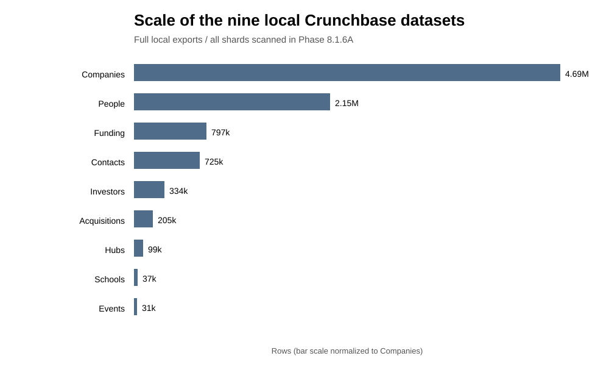
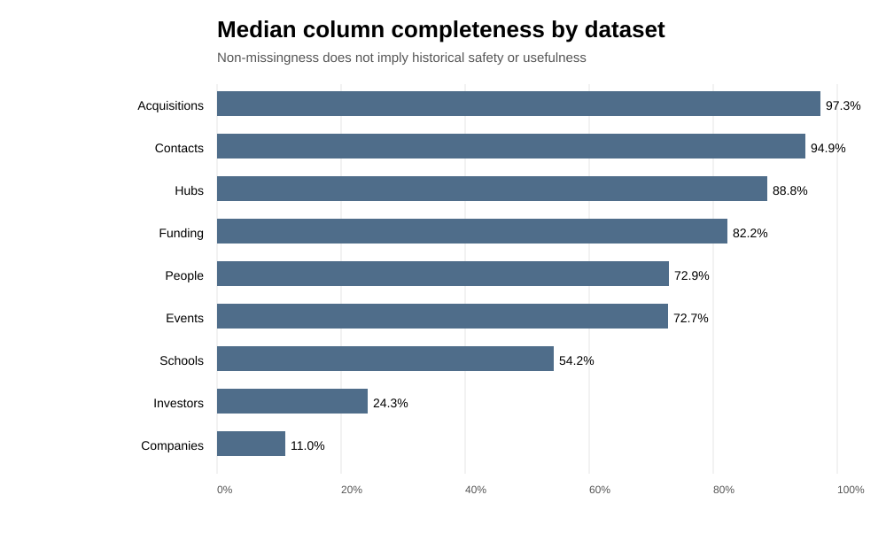
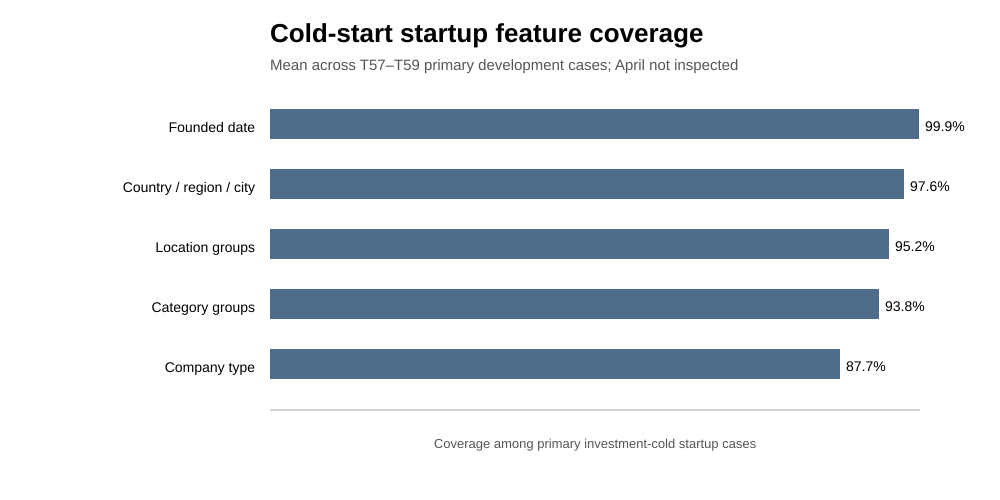
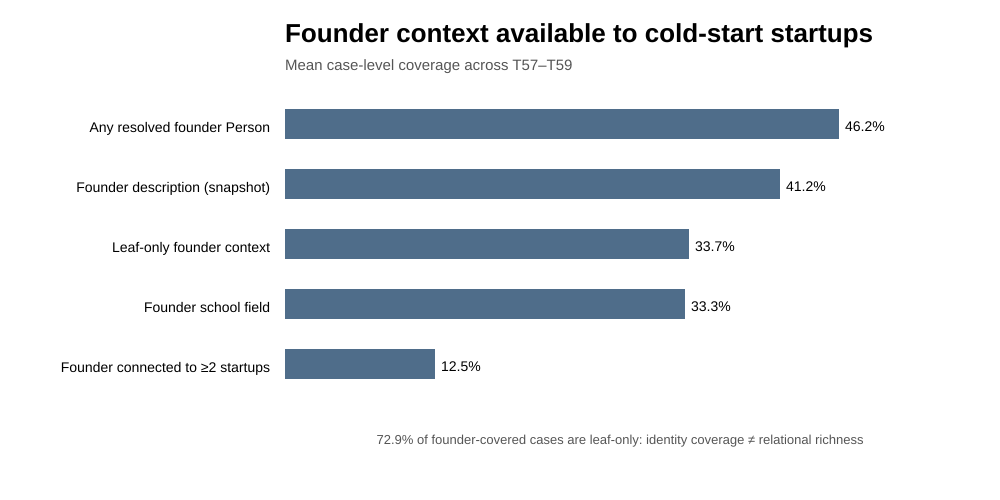
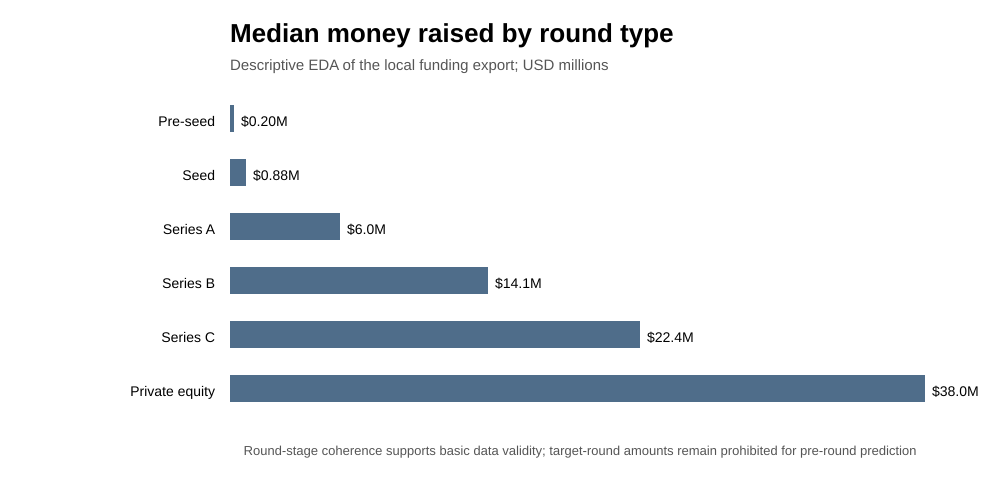

# Phase 8.1.8 — Comprehensive EDA and Feature Governance for Inductive Cold-Start Startup Representation

**Project:** ITRS Paper Reproduction / Master’s Thesis  
**Research target:** new-to-investor startup discovery under investment cold start  
**Data scope:** only the nine local Crunchbase dataset families already available in the project  
**Evaluation hygiene:** T57/T58/T59 development evidence only for cold-start coverage; **April confirmatory performance remains untouched**  
**Model status:** no new architecture selected; no M1/M2 training; no performance-based feature selection

---

## Executive summary

The local Crunchbase corpus is much richer than the original Phase 8.1.2 input contract suggests. A rigorous feature decision should not be based on the rule *“no timestamp = unusable.”* A better rule is to distinguish (i) timestamped historical events, (ii) intrinsic or slowly evolving snapshot attributes, (iii) dynamic but reconstructable historical information, (iv) dynamic/outcome-derived current snapshot variables, and (v) fields that are useful only for entity resolution.

The strongest recommendation from this EDA is therefore **not** to throw every available field into the model. Instead, build a compact, semantically defensible inductive representation that exploits the unusually rich side information without allowing current-state outcomes to leak backwards in time.

### Recommended primary startup-side information

1. **Description text** — already allowed.
2. **Fine-grained categories** — already allowed.
3. **Category groups** — coarse industry hierarchy; high coverage; useful but redundant enough to require ablation.
4. **Hierarchical geography** — preferably country + region/location group, rather than every geographic string simultaneously.
5. **Company type** — Crunchbase defines this as for-profit vs nonprofit, making it one of the most stable structured fields.
6. **Startup age at prediction origin** — derive as origin minus founded_on, never use raw calendar date as an uncontrolled predictor.
7. **Explicit Startup → Founder Person relation** — already justified by Phase 8.1.6D–F.
8. **Founder count derived from resolved founder edges**, rather than the raw current aggregate.
9. **Timestamped pre-origin acquisition context**, with acquisition type as a defensible relational ablation.
10. **Derived pre-origin founder experience**, especially serial-founder history and prior-sector experience reconstructed from founder links + founding dates.

The most important new idea from the expanded EDA is the last one: a cold startup can have **zero prior investment interactions while its founders have substantial pre-origin entrepreneurial history**. That history can be reconstructed from data already present in the nine datasets without using the startup’s own investment history.

### Information that should remain out of the primary model

Current funding stage, funding totals, number of investors/rounds, employee range, current revenue range, IPO/acquisition/operating status, Crunchbase ranks, Semrush traffic, current growth insights, current Person investment/exit counts, current organizations, and analogous current-state aggregates should remain prohibited. They are highly dynamic and can encode the future relative to a historical prediction origin.

### Information best reserved for ablations / sensitivity analyses

- Founder school relation and stable School attributes.
- Founder biography and current geography.
- Patent/trademark cumulative counts.
- Fine-grained city.
- Investor type/geography and reconstructed investor thesis attributes.
- Acquisition edge type / recency.
- Founder prior funding / exit experience.
- Contacts-derived team structure.

These channels are potentially informative, but either have weaker temporal provenance, introduce large scope changes, or would confound attribution of the thesis contribution.

---

## 1. Scientific objective of the EDA

The question is not:

> Which columns are populated?

It is:

> **Which information could legitimately describe an investment-cold startup at prediction time, and which information can be represented without memorizing startup identity or importing future outcomes?**

The feature-governance process therefore evaluates every candidate on six dimensions:

| Dimension | Question |
|---|---|
| Temporal provenance | Could the value have existed at the prediction origin? |
| Semantic stability | Is it intrinsic/slow-moving, or rapidly changing? |
| Outcome dependence | Does it directly encode funding, growth, exit, popularity, or later success? |
| Cold-start compatibility | Can it be computed without prior investment edges of the focal startup? |
| Redundancy | Does it add a genuinely different information channel? |
| Experimental attribution | Would adding it change a different component of ITRS and make the thesis result harder to interpret? |

### Temporal classes used in this report

**T1 — Strict timestamped event.** The event has an explicit date and can be gated at or before the origin.

**T2 — Derived strict historical feature.** Computed exclusively from T1 events available before origin.

**S1 — Intrinsic / slow-moving matched-snapshot attribute.** Not historically versioned, but describes relatively stable firm identity/context. May be used only with an explicit matched-snapshot caveat.

**S2 — Snapshot-biographical attribute.** Plausibly persistent but individual historical availability cannot be demonstrated from our local export.

**D1 — Dynamic current snapshot.** Changes materially through time; unsafe for historical prediction without reconstruction.

**O1 — Outcome-derived current snapshot.** Directly reflects future funding, acquisition, IPO, exit, popularity, or growth. Prohibited.

**R — Resolution/operational field.** Useful for joining entities, not as a predictive input.

This classification is stricter and more useful than a binary timestamp/no-timestamp rule.

---

## 2. Corpus inventory

| Dataset | Rows | Columns | Median completeness | Primary analytical role |
|---|---:|---:|---:|---|
| Companies | 4,689,624 | 88 | 10.99% | Startup-side content, attributes, founder links |
| People | 2,154,681 | 32 | 72.91% | Founder identities and founder-side context |
| Funding | 797,177 | 33 | 82.23% | Timestamped investor–startup interactions |
| Contacts | 724,553 | 30 | 94.89% | Selected current team/contact snapshot |
| Investors | 333,726 | 49 | 24.28% | Investor master and role metadata |
| Acquisitions | 204,525 | 35 | 97.29% | Timestamped non-target relational context |
| Hubs | 99,380 | 68 | 88.75% | Aggregate cohorts, not membership edges |
| Schools | 37,193 | 54 | 54.25% | School master for founder education context |
| Events | 31,261 | 23 | 72.68% | Timestamped event master without participants |

A central EDA lesson is that **completeness is not the same as usefulness**. Companies has low median completeness because the 88-column schema contains many sparse specialized fields, yet the startup variables most relevant to the thesis have very high coverage. Conversely, Contacts has very high completeness, but the table is a current, selected contact export and is much harder to use without historical leakage.

The multi-file entity tables are internally consistent at the schema level. The full scan found 14,227 duplicate-ID occurrences among 4.69M Company rows and only two among 2.15M People rows. Within the frozen 311,589 startup-role population, there are 541 duplicated startup IDs; the conflicts are concentrated in dynamic rank fields, while the structured fields considered here — geography, company type, category groups, founded date and founder links — showed no conflicts in the duplicate audit.

---

## 3. Companies: the richest primary source for inductive cold-start features

The frozen startup-role universe contains **311,589 startups**. Phase 8.1.6B scanned all 4,689,624 raw Company rows and matched 312,130 rows to those startup IDs.

### 3.1 Structured coverage in the primary cold-start cohorts

| Candidate | Mean primary T57–T59 coverage | Temporal class | Recommendation |
|---|---:|---|---|
| founded_on | 99.91% | T1 semantic event date | Use only to derive age / relation eligibility |
| country, region, city, locations | 97.57% | S1 | Use hierarchical geography |
| location_groups | 95.23% | S1 | Use, but avoid redundant duplication |
| category_groups | 93.75% | S1 | Use + ablate |
| company_type | 87.68% | S1 / intrinsic | Use + ablate |

The field semantics also support these choices. Crunchbase’s official data dictionary defines company_type as whether an organization is **for-profit or nonprofit**, and describes category_groups as broad industry groupings / supersets of industries. These are semantically different from funding stage or operating outcome.

Official documentation:
- https://data.crunchbase.com/docs/data-dictionary
- https://data.crunchbase.com/reference/getorganizationcard-2

### 3.2 Geography: use it, but encode it intelligently

The raw schema exposes several overlapping representations:

- locations
- country
- region
- city
- location_groups

A naive model that concatenates all five may overweight geography. The recommended primary representation is:

**country + region/location-group hierarchy**

with **city** retained as an ablation.

Why this matters economically: geographic fit is a core VC compatibility dimension. A startup can be completely investment-cold and still have a valid location signal.

Temporal caveat: headquarters can move. Therefore geography should be described as a **matched-snapshot, slowly evolving attribute**, not as guaranteed historical headquarters at T57/T58/T59.

### 3.3 Company type: a clean low-cardinality feature

Because Crunchbase defines company type as for-profit/nonprofit, this field is much safer than fields such as operating_status, funding_stage, or ipo_status.

Recommendation: **primary structured feature**, with a simple missing/unknown token.

### 3.4 Category groups: useful hierarchy, but explicitly test redundancy

categories and category_groups are related but not identical information:

- categories: fine-grained industry tags;
- category groups: higher-level industry families.

This hierarchy can help generalization when the exact category vocabulary is sparse. However, because category groups are derived from the same taxonomy, they should be included with an explicit ablation:

- content without category groups;
- content with category groups.

That lets the thesis state whether coarse hierarchy contributes beyond fine-grained categories.

### 3.5 Startup age is one of the cleanest new structured features

Instead of treating founded_on only as an eligibility field, derive:

**startup_age_at_origin = prediction_origin − founded_on**

This feature is origin-specific, cold-start compatible, and does not require investment history.

A 6-month-old company with zero investment history and a 12-year-old company with zero investment history represent meaningfully different discovery situations. The raw calendar founding year should not be fed blindly; **age at the prediction origin** is the scientifically cleaner quantity.

### 3.6 Fields that look attractive but are unsafe

The following Company fields should remain out of the primary historical model:

- num_employees_enum
- revenue_range
- funding_stage
- last_funding_type
- all funding totals
- num_funding_rounds
- num_investors, num_lead_investors
- operating_status
- ipo_status
- acquisition_status
- num_acquisitions
- Crunchbase rank / rank deltas
- Semrush traffic and global rank
- growth-insight fields

Their high coverage is **not an advantage** when the value is a 2026 current-state snapshot used to represent a 2025 or earlier prediction origin.

### 3.7 Patents / trademarks: interesting, but not primary

Companies includes IP-related cumulative counts and an IP score. These are tempting innovation signals. The problem is not conceptual relevance; it is temporal provenance. A cumulative 2026 count can include filings/grants after T57–T59.

Recommendation: **snapshot sensitivity only**, unless event-dated IP records exist locally (they do not in the nine-dataset scope).

---

## 4. Founders and People: the largest untapped cold-start opportunity

The founder analysis is one of the strongest findings of Phase 8.1.

- 184,393 startup-role organizations have a founder URL.
- 308,432 unique founder URLs were extracted.
- 308,422 resolve exactly to a People record: **99.9968% resolution**.
- Mean primary cold-start founder-Person coverage across T57–T59: **46.19%**.
- Adding explicit Person context recovers **38.32% of cases that were isolated under the existing founder-proxy graph**.
- Every founder-Person covered development case had a parseable founded_on and passed the semantic gate startup.founded_on <= origin.

### 4.1 Why explicit Person is better than only projected shared-founder edges

The existing projection keeps founder information mainly when a person connects multiple companies. But **91.30% of founder URLs have startup degree 1**. At the primary-case level, 72.94% of founder-covered cases are leaf-only.

Therefore:

> explicit Person nodes substantially improve **information retention**, but do not automatically create rich relational neighborhoods.

That is why founder-node design matters.

### 4.2 Do not solve leaf founders by dumping current Person features into the model

Resolved founders have broad snapshot coverage:

- description: 76.21% of resolved founder People globally;
- country: 85.16%;
- locations: 85.19%;
- schools: 44.75%;
- current organizations: 83.54%.

Yet those values are current snapshots. In particular:

- current_organizations is clearly dangerous;
- current investment/portfolio/exit counts are outcome-derived;
- description can mention later career achievements;
- primary_job_title can be post-origin.

The right response to leaf founders is not “use everything on People.”

### 4.3 A stronger derived feature: serial-founder experience before origin

We can construct a temporally meaningful founder-history feature **using only our current nine datasets**:

1. Resolve each Company’s founder_links to People.
2. For each founder, collect all companies they founded.
3. Use each company’s founded_on.
4. At origin t, count only companies with founded_on < t and exclude the focal startup.

Derived examples:

- number of prior companies founded;
- indicator: first-time vs serial founder;
- years since first prior founding;
- number of distinct prior industry groups;
- prior sector/category-group profile;
- prior geography profile.

This is substantially better than using raw people.num_founded_organizations, because the raw aggregate can include ventures founded **after** the prediction origin.

**Recommendation:** serial-founder history and prior-sector founder history should be promoted to the primary candidate set, with an explicit ablation.

### 4.4 Founder prior funding experience: valid but secondary

For each founder’s **prior companies**, join Funding events and include only events announced before the prediction origin.

Possible derived signals:

- number of prior funded ventures;
- number of prior pre-origin funding rounds;
- maximum stage reached by a prior venture before origin;
- previous investor diversity;
- founder’s prior sector-funding profile.

These are temporally reconstructable and cold-start compatible for the focal startup, but they can become powerful “founder pedigree” signals and complicate attribution.

Recommendation: **secondary founder-history ablation**, not mandatory primary representation.

### 4.5 Founder prior exit experience: also derivable

Using acquisition events dated before origin, a founder can be assigned historical exit experience when a prior company was acquired before the prediction origin.

This is scientifically cleaner than using current people.num_exits, but requires careful company/acquisition entity resolution.

Recommendation: **secondary ablation**.

---

## 5. Founder education and Schools: valuable, but temporal uncertainty is real

The local data does **not** contain education start/end dates. The People table gives a schools field; the School table is a rich organization master.

Current resolution results are encouraging:

- 138,026 / 308,422 resolved founders have a non-empty School field (44.75%).
- 107,020 founder People have a strictly resolved Person→School mapping under the conservative name-resolution policy.
- 87,823 startup nodes have strict founder-school context.
- Mean primary T57–T59 strict founder-school coverage: **27.80%**.

### 5.1 The important semantic nuance

It is reasonable domain knowledge that many founders complete at least part of their education before launching a company. However, the local export cannot prove **when a specific founder attended a specific school**.

Therefore, we should not silently convert:

> “founder is associated with School X”

into:

> “School X was definitely observable before the startup was founded.”

That would be stronger than the evidence supports.

### 5.2 Recommended treatment

Use Founder→School only as a **snapshot-biographical sensitivity track**, clearly labeled.

If this sensitivity is run, School-node features should be limited to relatively stable institution descriptors:

- school identity;
- school categories / category groups;
- school country / region / location group;
- school founded date / institution age if useful.

Do **not** use current School:

- Crunchbase ranks;
- Semrush metrics;
- current funding totals;
- current investors;
- employee counts;
- founder-alumni counts;
- current enrollment;
- contacts/articles.

Those fields describe the institution’s current 2026 state, not the founder’s education experience at the historical origin.

---

## 6. Funding: the cleanest temporal dataset

The Funding export is the strongest event table:

- **797,177** funding rounds;
- organization name: 100% coverage;
- announced_on: 100%;
- investment_type: 100%;
- organization website: 97.5%;
- categories: 98.1%;
- country: 99.0%;
- investor list: 75.6%;
- money raised USD: 70.2%;
- funding stage: 71.3%;
- investment stage: 58.0%;
- lead investors: 44.5%;
- pre-money valuation: only 5.7%.

Investor linkage from parsed round investor lists is strong:

- 1,339,156 investor mentions;
- 90.35% of mentions map to a unique investor record;
- 9.14% map to an ambiguous duplicated name;
- about 0.51% are unmatched;
- 93.7% of rounds with investors have at least one uniquely mapped investor.

### 6.1 Internal coherence

Median round size rises coherently with stage:

| Type | Median amount | Median investors |
|---|---:|---:|
| Pre-seed | $0.20M | 1 |
| Seed | $0.88M | 1 |
| Series A | $6.0M | 2 |
| Series B | $14.1M | 3 |
| Series C | $22.4M | 4 |
| Private equity | $38.0M | 1 |

This supports the basic economic coherence of the funding data.

### 6.2 What is allowed for the focal cold-start startup?

The focal startup is defined as investment-cold at origin, so its **prior investment history stays prohibited** in the primary representation even if event reconstruction could technically recover it.

That is not merely a leakage rule; it preserves the research cohort definition.

### 6.3 What can be derived for the investor?

From pre-origin Funding events, we can derive:

- stage/type preference;
- sector/category preference;
- geography preference;
- round-size preference;
- lead-investor frequency;
- co-investor network;
- recency / temporal drift.

These are scientifically valid because they can be reconstructed from dated events.

However, the primary thesis is intended to improve the startup-side representation while preserving the ITRS investor trend signal. Therefore these should be **secondary investor-side ablations**, not silently added to the main M2.

Official Crunchbase documentation confirms that investment_type is the funding type and investment_stage is the broader stage classification:
https://data.crunchbase.com/reference/funding-types

---

## 7. Investors: semantically useful, but protect experimental attribution

Important coverage from the Investor export:

- country: about 77%;
- investor type: about 57%;
- investor stage: about 24%;
- portfolio/investment activity counts: about 53%;
- exits: about 16%;
- website: about 40%.

Investor type is multi-label in practice and includes combinations such as VC, private equity, accelerator, angel and government roles.

### Primary recommendation

Keep the primary M2 investor branch as close as possible to ITRS. The following can be tested later:

- investor_type — strong semantic value, relatively stable;
- investor geography — useful fit signal;
- snapshot investor description/categories — potentially useful thesis signal.

But changing the investor encoder at the same time as the startup encoder would weaken attribution.

### Exclude raw current activity summaries

Do not use current:

- portfolio count;
- number of investments;
- number of lead investments;
- exits;
- funding-stage association.

These are strongly correlated with investor size/activity and can include activity after the historical origin. The previous audit found a Spearman correlation of **0.968** between portfolio organizations and investment-round count, confirming heavy redundancy.

---

## 8. Acquisitions: high-quality timestamped relational context

The Acquisition export contains **204,525** events with complete announcement dates and participant names.

Useful fields:

- announced_on — strict temporal gate;
- acquirer / acquiree identity;
- acquisition_type — potential typed edge;
- participant geography/categories as resolution/context aids.

Crunchbase’s official dictionary defines acquisition_type as the transaction type and announced_on as the acquisition announcement date:
https://data.crunchbase.com/docs/data-dictionary

### Recommended primary use

Continue using pre-origin acquisitions as non-target heterogeneous structure.

### Recommended relational ablation

Add **acquisition type** as an edge type / edge attribute. This is semantically clean because it belongs to the dated event itself rather than to a later current-state snapshot.

A second optional ablation is acquisition recency: prediction origin minus announced_on.

### Do not use participant current-state summaries from acquisition rows

Fields such as acquiree funding stage, participant current revenue or funding totals can represent current snapshots copied onto historical events. In the local acquisition file, acquiree_funding_stage is m_and_a for every row and is clearly not a useful pre-event startup feature.

Acquisition price is only about 16.3% populated and is unnecessary for the primary structural relation.

---

## 9. Contacts: rich table, weak historical provenance

The Contacts export has **724,553** rows and very high column completeness, but that makes it especially easy to misuse.

Key facts:

- 715,763 unique normalized LinkedIn handles;
- 76,165 unique organization names;
- every observed contact organization name appears in the Funding table;
- 86.6% of contact rows map to a funding organization name unique with respect to observed website domains;
- 13.4% remain ambiguous under that key;
- organization_uuid and organization_permalink are empty;
- contact IDs are not canonical People IDs;
- median contacts per organization: 3;
- 95th percentile: 31;
- maximum: 1,000.

The table can reveal team departments and seniority through job_departments and job_levels, which sounds attractive for startup quality. But it is a **current selected contact snapshot**. A startup’s 2026 team composition can be dramatically different from its team at T57/T58/T59.

### Recommendation

**Exclude from the primary historical predictor.**

Useful roles:

- descriptive EDA;
- entity-resolution assistance using LinkedIn/name/organization;
- a clearly separated snapshot-only sensitivity experiment if the thesis later needs it.

---

## 10. Events: rich event descriptions, no participant bridge

The Event export contains 31,261 rows and explicit starts_on / ends_on, event types, categories and geography.

However, the local table does not identify speakers, sponsors, exhibitors, contestants, attendees or participating organizations. It contains only **counts** of those roles.

Therefore it cannot support Startup→Event or Person→Event relations within the current nine-dataset constraint.

The previous data-quality audit also found meaningful duplicate-event risk.

### Recommendation

Exclude Events from the primary heterogeneous graph. Use only for descriptive ecosystem context if needed.

---

## 11. Hubs: high completeness, wrong grain for the thesis

Hubs are aggregated Crunchbase cohorts, such as:

- companies in an industry/location;
- portfolio-company collections;
- trending lists.

They contain aggregate funding, IPO, acquisition and principal statistics, not a clean membership table.

In addition, company hub_tags has negligible usable coverage in our Company data (about 0.1% in the relation-semantics audit).

### Recommendation

Exclude Hub nodes and hub aggregate metrics from the primary model.

This is a good example of why dataset size/completeness should not drive feature selection.

---

## 12. Cross-entity opportunities that are more valuable than adding random columns

This is the most important section of the EDA.

### 12.1 Founder serial-entrepreneur history

**Source:** Company founder links + People identity + Company founded date.

For a founder, focal startup and origin, construct the set of prior ventures as all non-focal companies founded by that person before the origin.

Derived features:

- prior_founded_count;
- is_serial_founder;
- time since first prior founding;
- number of prior industry groups;
- prior sector/category-group profile;
- prior geography profile.

This uses no investment history of the focal startup.

### 12.2 Founder prior domain experience

For the prior ventures above, aggregate their categories/category groups.

Examples:

- founder has previously founded in AI;
- founder’s prior companies span FinTech + enterprise software;
- founder’s prior ventures match the focal startup’s sector.

This can be encoded as a pooled prior-founder category vector.

Caveat: the prior companies’ category labels are current-snapshot semantics, so the edge timing is strict but the category taxonomy itself remains matched-snapshot.

### 12.3 Founder prior funding track record

Join a founder’s prior companies to Funding events strictly before origin.

Possible features:

- any prior funded venture;
- pre-origin prior rounds count;
- prior maximum observed round type/stage;
- historical investor diversity.

This is temporally strong, but should be a secondary ablation because it adds substantial complexity and may dominate simple startup attributes.

### 12.4 Founder prior exit track record

Join prior founder companies to acquisitions announced before origin.

This creates a legitimate historical founder-experience signal without using current people.num_exits.

Again, use as an ablation unless the thesis scope explicitly elevates founder track record to the primary contribution.

### 12.5 Derived relational features beat current summary columns

A general rule emerges:

> If a current Crunchbase aggregate can be reconstructed from timestamped pre-origin events, prefer the reconstructed historical feature.

| Unsafe raw snapshot | Better pre-origin construction |
|---|---|
| num_funding_rounds | count Funding events before t |
| current funding total | sum pre-origin round amounts |
| raw investor stage | distribution of pre-origin investment stages |
| current Person exits | acquisitions of prior founder companies before t |
| raw num_founded_organizations | count founder-linked companies founded before t |

This principle should become part of the Phase 8.1.7 V2 contract.

---

## 13. Feature-governance decision matrix

A machine-readable version is included in [feature_governance_matrix.csv](feature_governance_matrix.csv).

### Tier A — Primary allowed / recommended

- Startup description.
- Startup categories.
- Startup category groups.
- Startup hierarchical geography.
- Startup company type.
- Startup age at origin.
- Explicit Startup→Founder Person.
- Resolved founder count.
- Derived serial-founder / prior-founder sector history.
- Timestamped acquisition relation.
- Acquisition type as a typed-relation option.
- Existing ITRS investor trend representation.

### Tier B — Developer-only ablations

- Remove category groups.
- Remove geography.
- Remove company type.
- Remove startup age.
- Remove explicit founder relation.
- Remove prior-founder history.
- Shared-founder projection vs explicit Person.
- Acquisition type on/off.
- Acquisition recency on/off.
- Fine-grained city.
- Founder prior funding history.
- Founder prior exit history.
- Investor type/geography extension.

### Tier C — Snapshot sensitivity only

- Founder school relation.
- Stable School context.
- Founder current geography.
- Founder biography.
- Cumulative patent/trademark signals.
- Contacts-derived team structure.

These should not be mixed with the primary result; if reported, label them explicitly as matched-snapshot / sensitivity experiments.

### Tier D — Prohibited from primary historical prediction

- Current startup employees/revenue.
- Current funding stage/type/totals.
- Current investor/round counts.
- Current acquisition/IPO/operating status.
- Rank and rank deltas.
- Semrush/web traction.
- Growth-insight fields.
- Current Person organizations.
- Current Person investment/portfolio/exit counts.
- School current funding/rank/web/employee aggregates.
- Hub aggregate outcome metrics.

### Tier R — Resolution only

- website;
- Crunchbase link;
- LinkedIn;
- contact email;
- names when combined with stronger identifiers.

### Fairness-only field

- Person gender must **not** be a ranking feature. If retained anywhere, its role should be limited to fairness diagnostics with appropriate care.

---

## 14. Recommended experimental ladder

The goal is to exploit the enriched data **without destroying experimental attribution**.

### B0 — Frozen reproduced ITRS

Unchanged.

Purpose: baseline comparability.

### B1a — Original inductive content baseline

Startup:
- description;
- categories.

No startup identity latent vector or learned per-startup Doc2Vec document vector.

Purpose: establish the value of identity-free content alone.

### B1b — Structured inductive startup representation

B1a plus:

- category groups;
- country + region/location-group representation;
- company type;
- startup age at origin;
- resolved founder count.

Purpose: test whether stable structured metadata adds value beyond text/categories.

### M1 — Inductive heterogeneous startup model, no trend

B1b plus:

- explicit Founder Person;
- timestamped acquisition relation;
- founder prior-venture / prior-sector context.

No trend-aware investor component.

Purpose: isolate heterogeneous startup representation.

### M2 — Proposed model

Same startup representation as M1 plus the **preserved ITRS trend-aware investor representation**.

Purpose: directly test the thesis hypothesis: can a trend-aware recommender improve new-to-investor discovery when the cold startup is represented inductively rather than by investment-history-dependent identity?

### Sensitivity track S1 — Founder education

M2 + Founder→School + stable School context.

Report separately as **snapshot-biographical sensitivity**, not strict temporal evidence.

### Secondary extension S2 — Richer investor thesis

Add investor type/geography or pre-origin reconstructed investor stage/sector profile.

Only run if needed after the primary thesis experiment, because this changes the investor side and weakens attribution.

---

## 15. Ablation plan

The ablations should be predeclared before training, not opened opportunistically after seeing April.

| Ablation | Question |
|---|---|
| – category groups | Does coarse taxonomy add beyond categories? |
| – geography | How much does geographic fit matter? |
| – company type | Does stable organizational form contribute? |
| – startup age | Is lifecycle maturity informative in true investment-cold cases? |
| – explicit Founder Person | Is founder structure itself useful? |
| – founder prior-history | Is serial/domain founder experience the informative part? |
| shared-founder vs explicit Person | Does preserving founder identity beat projection? |
| acquisition untyped vs typed | Does transaction type add relational meaning? |
| no heterogeneous branch | How much comes from structured/content features alone? |
| no trend | What is the incremental value of ITRS trend modeling after the startup side becomes inductive? |

Founder-School should be analyzed separately from the main ablation table because of its weaker temporal provenance.

---

## 16. Data-quality caveats that must appear in the thesis

1. **Matched-snapshot limitation.** Description, categories, category groups and geography are not historically versioned in these local exports.
2. **Founder observation-time limitation.** founded_on gives a semantic effective-date proxy for a founder edge, not the date Crunchbase first recorded the relationship.
3. **School temporal ambiguity.** Person→School has no attendance dates locally.
4. **Company duplicate IDs.** Full Company data contains duplicate ID occurrences; the startup subset audit showed dynamic rank-field conflicts but stable candidate fields were consistent.
5. **Funding participant parsing.** Investor names are mostly resolvable but ambiguous duplicate names and comma-containing legal names require careful parsing.
6. **Contacts selection bias.** The contacts file is not a historical workforce table.
7. **Event duplication / no participant identifiers.**
8. **Hub grain mismatch.** Hubs are aggregate cohorts, not reliable company membership edges.
9. **Acquisition duplicates/aliases.** Preserve provenance and avoid blindly deleting natural-key duplicates.
10. **No April feature exploration.** The confirmatory cohort must remain untouched until the final frozen pipeline.

---

## 17. Decision on Phase 8.1.7 V1

**Preserve V1 unchanged as an audit artifact, but do not treat it as the final input contract.**

V1 was scientifically conservative and correctly approved explicit Founder Person, but it prematurely prohibited structured startup attributes that the EDA now supports under a matched-snapshot caveat.

A later **Phase 8.1.7 V2** should supersede—not overwrite—V1 and should explicitly distinguish:

- primary stable/snapshot attributes;
- derived strict pre-origin features;
- primary heterogeneous relations;
- sensitivity-only channels;
- prohibited dynamic/outcome snapshot fields.

The graph schema should not be frozen until V2 is written.

---

## 18. Recommended Phase 8.1.7 V2 content

### Allow in the primary startup encoder

- description;
- categories;
- category groups;
- hierarchical geography;
- company type;
- age at origin;
- derived resolved-founder count.

### Allow in the primary heterogeneous branch

- explicit Startup→Founder Person, semantically gated by startup founded_on;
- timestamped pre-origin acquisitions;
- derived pre-origin founder serial/domain experience.

### Allow as typed relational ablation

- acquisition type;
- acquisition recency.

### Snapshot sensitivity only

- Founder→School;
- stable School context;
- founder biography/geography;
- current cumulative IP fields.

### Secondary investor-side extension only

- investor type;
- investor geography;
- investor stage/sector preference reconstructed from pre-origin Funding events.

### Explicitly prohibit

All current-state funding, growth, rank, web-traffic, workforce, outcome and current Person career/activity variables listed in the governance matrix.

---

## 19. Bottom-line recommendation

The data is rich enough to support a much stronger inductive cold-start model than the original content-only design, **without resorting to questionable current success indicators**.

The scientifically strongest representation is not “more columns.” It is a combination of distinct information channels:

**Startup intrinsic content + stable structured context + founder human-capital history + timestamped heterogeneous relations**

where each channel has an explicit provenance rule.

The biggest opportunity in the nine available datasets is **not** current funding or popularity metadata. It is the ability to reconstruct information that exists even before a startup has investment history:

- what the startup does;
- where it is;
- what kind of organization it is;
- how old it is;
- who founded it;
- whether those founders are first-time or serial founders;
- what sectors their prior ventures belonged to;
- whether their prior ventures had historical funding/exits before the current origin;
- what non-target acquisition structure existed before the origin.

That is exactly the kind of information an inductive cold-start recommender should exploit.

---

## 20. Provenance of this report

Numerical statistics in this document come from the project’s previously completed full-row EDA/audit artifacts (Phases 8.1.4–8.1.6), including full scans of all 24 Company shards, all 11 People shards and the seven single-file datasets. This report adds a fresh semantic/temporal feature-governance synthesis using the raw local schemas and selected raw records from the Library. It does **not** use any model-performance result to choose features.

Official field semantics were cross-checked against Crunchbase’s public documentation:

- Data Dictionary: https://data.crunchbase.com/docs/data-dictionary
- Organization card / company type and category groups: https://data.crunchbase.com/reference/getorganizationcard-2
- Funding types and stages: https://data.crunchbase.com/reference/funding-types

Only the nine local datasets listed in this report are proposed for the thesis; no additional Crunchbase entities are assumed to be obtainable.

---

### Companion artifacts

- [Dataset summary](dataset_summary.csv)
- [Feature governance matrix](feature_governance_matrix.csv)
- [Dataset scale chart](charts/dataset_scale.svg)
- [Dataset completeness chart](charts/dataset_completeness.svg)
- [Startup feature coverage chart](charts/startup_feature_coverage.svg)
- [Founder context chart](charts/founder_context.svg)
- [Funding round medians chart](charts/funding_round_medians.svg)
